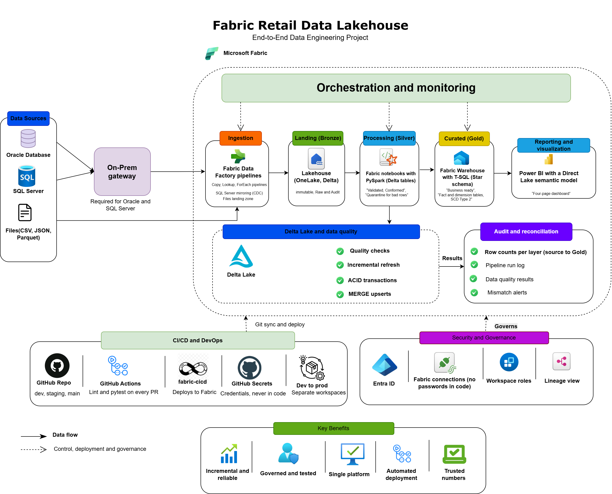

# Global Retail Analytics Platform

End-to-end data engineering project on Microsoft Fabric. Operational data from
Oracle, SQL Server and partner files is ingested through an on-premises gateway
into a medallion lakehouse (Bronze, Silver, Gold) and served to Power BI.



## Business problem
A marketplace retailer keeps orders in Oracle, master data in SQL Server and
partner feeds as files. Analysts cannot answer basic questions (revenue, delivery
performance, seller quality) without manual joins. This platform unifies the
three sources into a tested, documented warehouse.

## Data sources
The Olist Brazilian E-Commerce dataset (100K+ orders, 9 tables), split across
three systems so each plays a realistic role:

| Source | Content | Planned ingestion |
|---|---|---|
| Oracle | orders, order items, payments | Pipeline copy, incremental by watermark, via gateway |
| SQL Server | customers, sellers, products, geolocation | Fabric mirroring (change data capture) |
| Files | reviews and daily JSON/Parquet partner drops | Landing zone to Bronze |

The daily files contain duplicates, late-arriving data and a schema change on
purpose, so the pipeline has real problems to solve.

## Layers
| Layer | Engine | What happens |
|---|---|---|
| Bronze | Lakehouse (Delta) | Raw data plus audit columns |
| Silver | Spark notebooks (PySpark) | Dedupe, cleanse, validate, quarantine bad rows, MERGE upserts |
| Gold | Fabric Warehouse (T-SQL) | Star schema, SCD Type 2 customer dimension |
| Serving | Direct Lake and Power BI | Four-page report |

## Engineering practices
- Incremental, metadata-driven ingestion with audit and reconciliation tables
- Data quality rules, a results table and a quarantine pattern
- Unit tests for transformation functions (pytest)
- Secrets in `.env` and Fabric connections, never in code
- Branching: `feature/*` to `dev` to `staging` to `main`, with a protected `main`
- Git-integrated Fabric workspaces and CI/CD with GitHub Actions

## Set up the source systems locally
1. Install Oracle Database Free, SQL Server Developer, SSMS, ODBC Driver 18 and Python.
2. Download the Olist CSVs into `data/raw/` (not committed).
3. Create the Oracle user and tables: `sources/00_oracle_create_user.sql`, `sources/01_oracle_tables.sql`.
4. Create the SQL Server database and tables: `sources/02_sqlserver_tables.sql`.
5. Copy `.env.example` to `.env` and fill in your connection details.
6. Install packages and load the data:

```
python -m venv .venv
.venv\Scripts\Activate.ps1
pip install -r sources\requirements.txt
python sources\load_sources.py --target sqlserver --data-dir data\raw
python sources\load_sources.py --target oracle --to-date 2018-06-30
python sources\generate_daily_files.py --days 7 --events-per-day 800
```

Oracle is loaded only up to 30 June 2018, so later days can be loaded in slices
to practise incremental loading.

## Repository structure
| Folder | Purpose |
|---|---|
| `sources/` | DDL, loader and file generator for the three sources |
| `fabric/` | Items synced from the Fabric workspace (pipelines, notebooks, warehouse) |
| `transformation/` | Reusable PySpark functions |
| `warehouse/` | T-SQL scripts for Gold |
| `tests/` | pytest suite |
| `ci_cd/` | Deployment scripts |
| `scripts/` | Utility scripts |
| `docs/` | Diagrams, data dictionary, runbook, screenshots |

## Key design decisions
| Decision | Why |
|---|---|
| Mirroring for SQL Server, pipelines for Oracle | To be filled in after the ingestion weeks |
| Silver in Spark, Gold in T-SQL | To be filled in after the Gold layer |

## Status
Preparation week complete: source systems, data loading, architecture and
repository structure. Fabric build in progress.

## Author
Karun Sai Chowdary · [LinkedIn](https://www.linkedin.com/in/karun-sai)